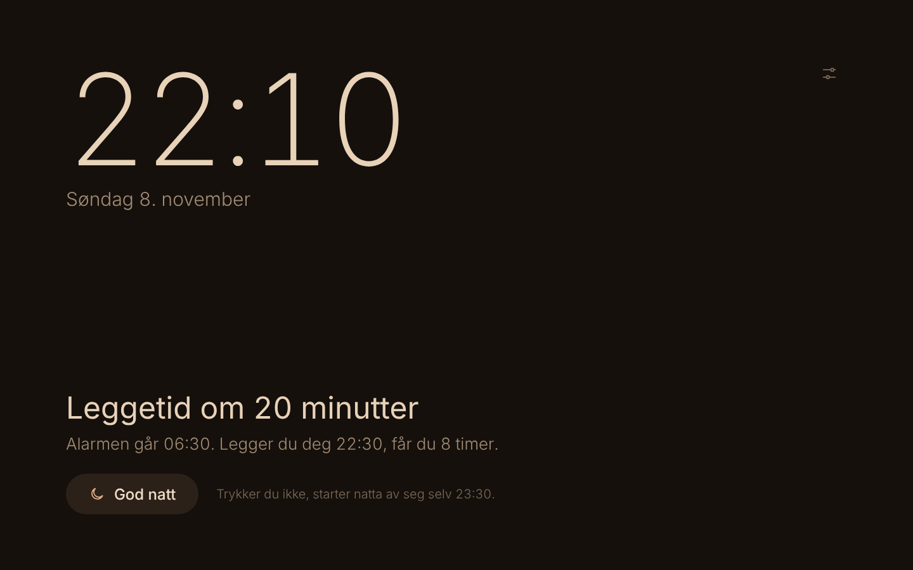
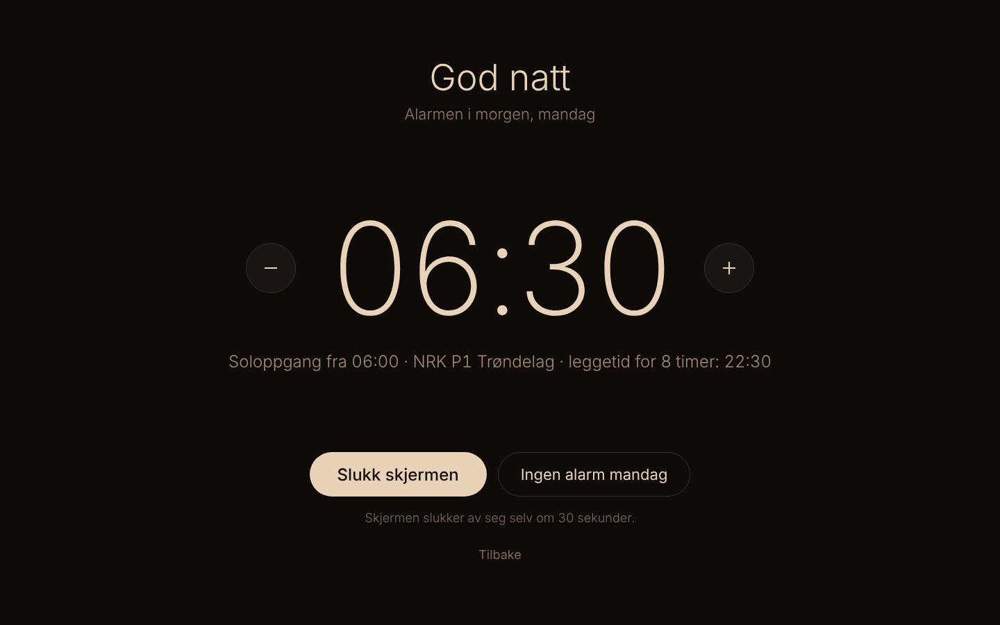
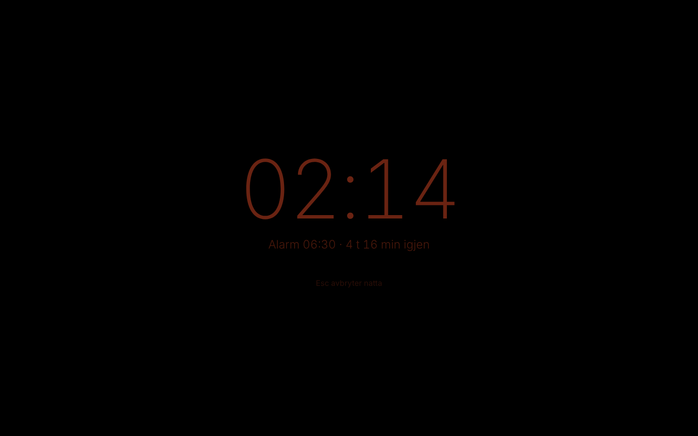
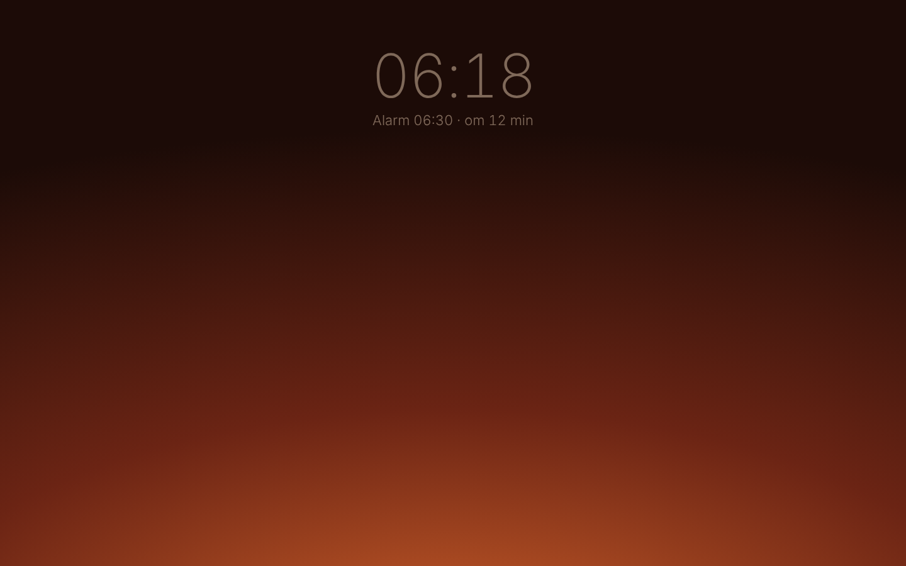
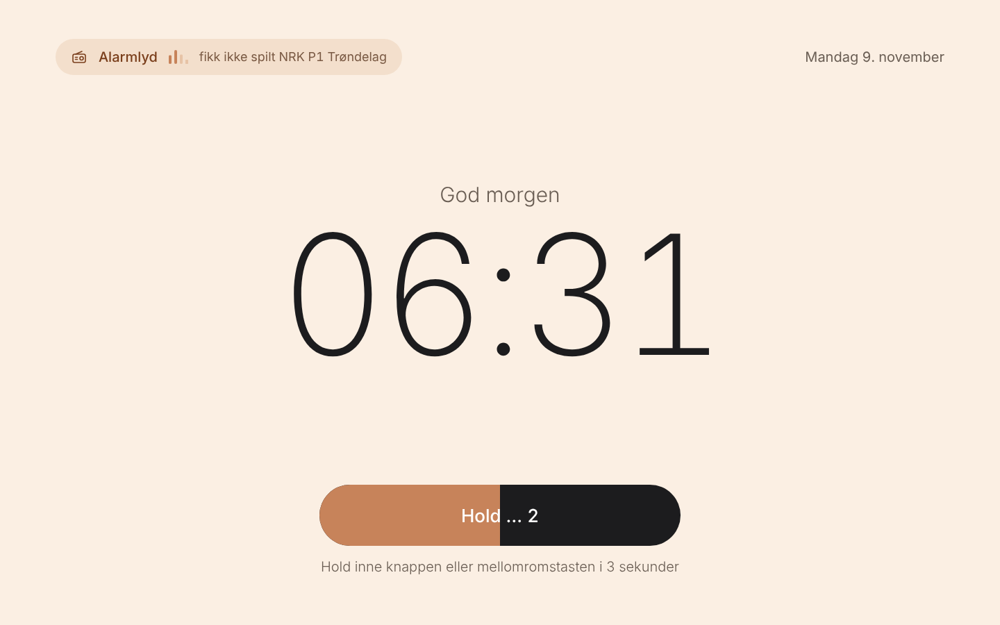
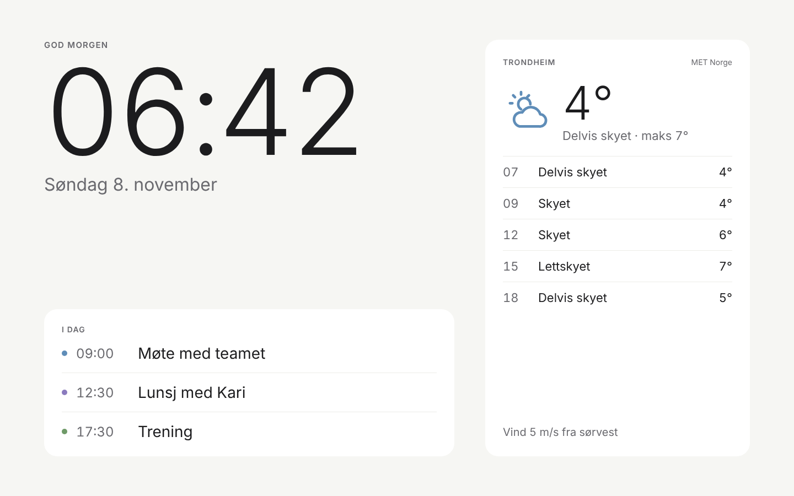

# Vane vekkerklokke

En rolig vekkerklokke for en gammel Mac på nattbordet, i samme stil som [Vane](https://github.com/egeiran/vane). Om kvelden blir skjermen varm og dempet og sier fra når det er leggetid. Om natta er skjermen helt av. En halvtime før alarmen går skjermen fra svart til varmt lys, og så vekker NRK P1 Trøndelag deg med lyd som øker sakte. Om morgenen ser du været og dagens avtaler, og om dagen står klokka dempet.

Alt kjører på Macen, på `localhost`. Ingen konto og ingen sky.

| Kveld | God natt | Natt (glimt) |
| --- | --- | --- |
|  |  |  |
| **Soloppgang** | **Alarm** | **Morgen** |
|  |  |  |

## Døgnet

1. **Dag:** dempet klokke, været og neste avtale.
2. **Kveld** (fra 21:30, eller en time før leggetid hvis det er tidligere): varm og mørk. Leggetiden er alarmen minus søvnen du vil ha (8 timer). «Leggetid om 20 minutter» kommer av seg selv.
3. **God natt:** viser alarmen for i morgen. Juster med − og + (5 minutter om gangen), eller velg ingen alarm. Endringen gjelder bare den ene morgenen. Skjermen slukker etter 30 sekunder, eller når du trykker «Slukk skjermen». Trykker du ikke God natt, starter natta av seg selv en time etter leggetid.
4. **Natt:** skjermen er slått helt av. Rører du musa eller tastaturet, vises klokka svakt i rødt i ti sekunder. Esc i glimtet avbryter natta.
5. **Soloppgang:** 30 minutter før alarmen slås skjermen på og går fra svart via dyp rød og oransje til varmt lys.
6. **Alarm:** radioen starter lavt, og Macen skrur opp volumet over tre minutter. Hold inne knappen eller mellomromstasten i 3 sekunder for å skru av. Du kan også skru av under soloppgangen med mellomromstasten. Alarmen gir seg etter en time.
7. **Morgen:** klokka, dagens avtaler og været i 45 minutter. Så blir det dag igjen.

Uten alarm (helg som standard) varer natta til 09:00.

## Sette opp på Macen

Du trenger macOS, [Node](https://nodejs.org) 22.18 eller nyere (`brew install node`) og Google Chrome.

```bash
git clone https://github.com/egeiran/vane-web
```

```bash
cd vane-web && ./scripts/install.sh
```

Skriptet installerer pakkene, bygger nettsiden og legger inn to LaunchAgents: serveren, som alltid kjører, og Chrome i fullskjerm, som åpnes når du logger inn. Kjør det på nytt etter `git pull`. `./scripts/uninstall.sh` fjerner dem igjen.

### Innstillinger på Macen

- **Låsskjerm:** sett «Krev passord etter at skjermspareren starter eller skjermen slås av» til *Aldri*. Ellers møter låseskjermen deg i stedet for soloppgangen.
- **Logg inn automatisk** (Brukere og grupper), så vekkerklokka starter av seg selv etter et strømbrudd.
- **Batteri → Alternativer:** slå på «Hindre automatisk dvale på strømadapter når skjermen er av». Serveren holder også Macen våken selv (`caffeinate`), men dette er en ekstra sikring.
- **Skjerm:** slå av automatisk lysstyrke og sett lysstyrken ganske høyt, så soloppgangen merkes. Natta er uansett helt mørk, fordi skjermen slås av.
- **Lokket åpent og laderen i.** En MacBook med lokket lukket sover, og da går ikke alarmen.

Prøv alarmen under Innstillinger (knappen nede på dagskjermen og kveldsskjermen): «Prøv alarmen om ett minutt» gir en kort soloppgang og så alarm.

### Kalender

Google Kalender på nett → Innstillinger → velg kalenderen → «Hemmelig adresse i iCal-format». Lim den inn under Innstillinger → Vær og kalender. Adressen lagres bare i `data/config.json` på Macen.

### Radio

Standard er NRK P1 Trøndelag (`https://lyd.nrk.no/nrk_radio_p1_trondelag_mp3_h`). Alle strømmer Chrome kan spille, kan brukes. Kommer det ikke lyd innen 15 sekunder, eller faller strømmen ut, spilles den innebygde alarmlyden i stedet. Får heller ikke nettsiden spilt den, spiller serveren den selv med `afplay`. Du blir altså vekket uansett.

## Feilsøking

- Loggen ligger i `~/Library/Logs/vane-web.log`. Hver fase skrives dit («Fase: night → sunrise»).
- Åpne http://127.0.0.1:4545 i en vanlig nettleser for å se det samme som kioskvinduet.
- Start serveren på nytt:

```bash
launchctl kickstart -k gui/$(id -u)/no.egeiran.vane-web.server
```

- Chrome i fullskjerm lukkes med ⌘Q og startes igjen med `./scripts/kiosk.sh`.

## Utvikling

```bash
npm install
```

```bash
npm run server
```

```bash
npm run dev
```

`npm run server` starter serveren (og starter den på nytt når koden endres). `npm run dev` starter nettsiden med hot reload på http://localhost:5173, som sender `/api` videre til serveren. Utenfor macOS skriver serveren til loggen i stedet for å slå av skjermen og endre volumet.

`VANE_NOW` starter klokka på et annet tidspunkt, så du kan se døgnet uten å vente. Klokka går videre derfra.

```bash
VANE_NOW=2026-11-09T06:20 npm run server
```

```bash
npm test            # logikken, vær, kalender og serveren
npm run typecheck
npm run build
```

Node kjører TypeScript direkte (type stripping), så serveren har ikke noe byggesteg. Derfor: `.ts` på slutten av importer, `import type` for typer, og ingen `enum` eller parameteregenskaper.

| Mappe | Innhold |
| --- | --- |
| `src/shared` | Ren logikk som brukes av både server og nettside: tid, døgnet (`schedule.ts`), soloppgangsfarger, vær og kalender. Testet. |
| `src/server` | Serveren: HTTP og Server-Sent Events (`http.ts`), vekkeren som gjør noe når fasen endrer seg (`vekker.ts`), Macen (`mac.ts`), MET (`weather.ts`) og iCal (`ical.ts`). |
| `src/web` | Nettsiden i React: én skjerm per fase. |
| `scripts` | Installasjon på Macen, kioskvinduet og alarmlyden (`make-chime.ts`). |
| `test` | Tester med `node --test`, med et ekte varsel fra MET og en testkalender. |

## Personvern

Alt lagres i `data/` på Macen. Serveren lytter bare på `127.0.0.1` og henter bare været fra Meteorologisk institutt (data fra MET Norge, CC BY 4.0), kalenderen fra adressen du legger inn, og radiostrømmen. Ingen statistikk og ingen sporing.

## Senere

Kobling til Vane-appen: når Vane får synk med iCloud ([egeiran/vane#11](https://github.com/egeiran/vane/issues/11)), kan vekkerklokka lese dagens vaner med CloudKit JS. Se [veikartet i Vane](https://github.com/egeiran/vane/blob/main/docs/retning.md).
